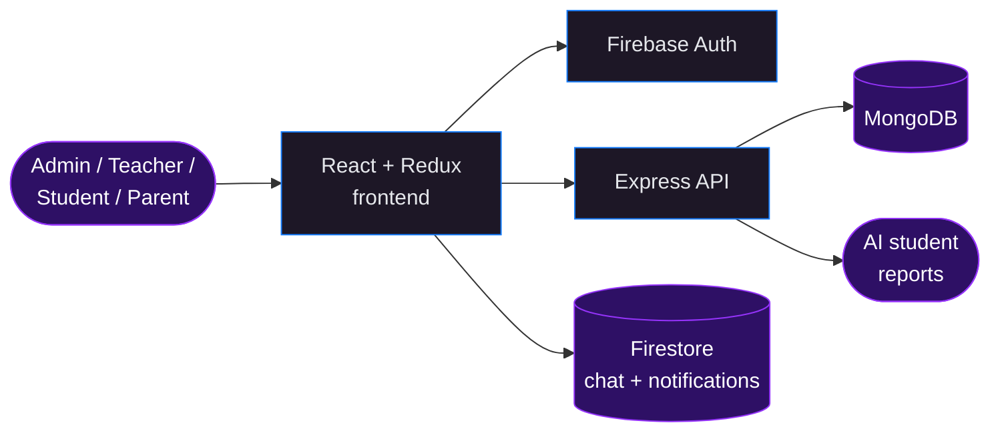

<!-- styled:v2 -->
<div align="center">


**A full-stack MERN school management system for admins, teachers, students and parents, with attendance, fees, chat and AI-written student reports.**

<p>
  
  
  
  
  
  
</p>

<p>
  <a href="#overview">Overview</a> ·
  <a href="#how-it-works">How it works</a> ·
  <a href="#features">Features</a> ·
  <a href="#tech-stack">Tech stack</a> ·
  <a href="#project-structure">Project structure</a> ·
  <a href="#getting-started">Getting started</a>
</p>

</div>

---

## Overview

Schools juggle attendance sheets, fee records and parent messages across paper and WhatsApp. EMTS puts them in one web app with a separate dashboard for every role, real-time chat and AI-generated performance reports for each student.

## Features

| Role | What they can do |
|:--|:--|
| 🛡️ **Admin** | Manage teachers, students and classes, track fees, message teachers |
| 👩‍🏫 **Teacher** | Mark attendance, record results, chat with admin and parents |
| 🎓 **Student** | See attendance, results and fee status |
| 👪 **Parent** | Monitor their child's attendance and progress, chat with teachers |

- Login and registration with Firebase Authentication
- Attendance management and fee tracking
- Real-time chat and notifications (Firebase Firestore)
- AI-based student performance reports
- Role-based dashboards and protected routes

## How it works



## Tech stack

| Layer | Tools |
|:--|:--|
| Frontend | React, Redux Toolkit, React Router, Bootstrap, Tailwind CSS |
| Backend | Node.js, Express, Mongoose |
| Data | MongoDB, Firebase Firestore |
| Auth | Firebase Authentication |

## Project structure

```
├── backend/     # Express API: controllers, models, routes, index.js
└── frontend/    # React app: pages, components, redux, firebase.js
```

## Getting started

```bash
cd backend && npm install
cd ../frontend && npm install
```

Create `backend/.env`:

```env
MONGO_URL=your_mongodb_connection_string
FIREBASE_API_KEY=your_firebase_api_key
PORT=5000
```

```bash
cd backend && npm start     # http://localhost:5000
cd frontend && npm start    # http://localhost:3000
```

## License

MIT

---

<div align="center">

**Built by [Ch Muhammad Samiullah](https://github.com/samiullah156-creator)** · AI Automation Engineer and Full-Stack Developer at [Lexvaxa](https://lexvaxa.com)

<a href="https://github.com/samiullah156-creator"></a>
<a href="https://lexvaxa.com/contact"></a>
<a href="https://www.linkedin.com/in/sami-lexvaxa/"></a>

<sub>⭐ Star this repo if you found it useful</sub>

</div>


